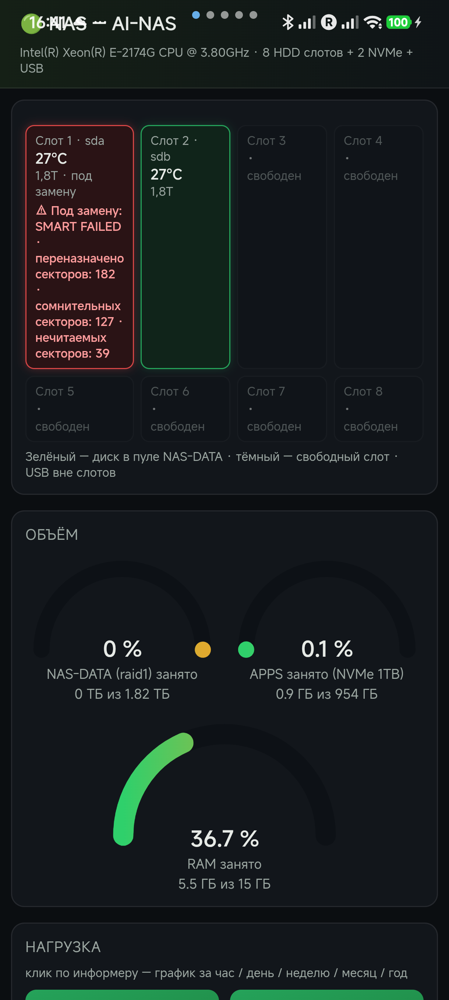
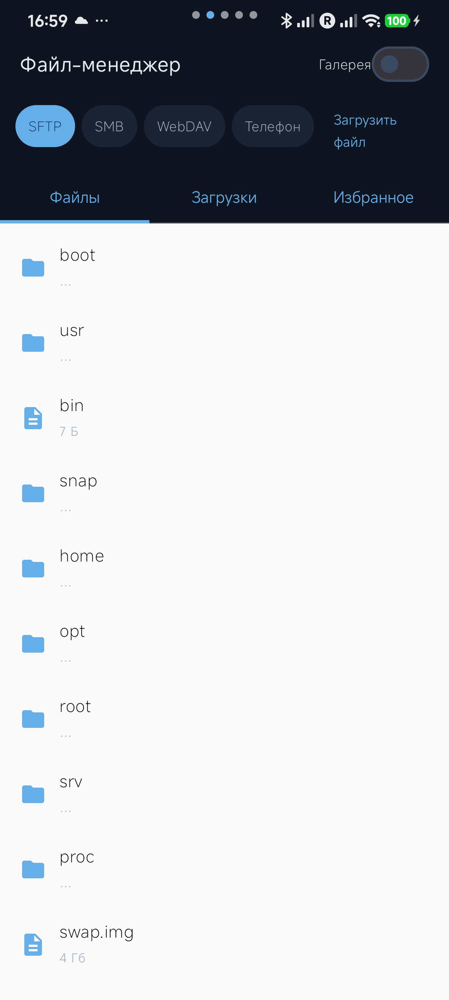

#  🚀 Ai NAS — Android-клиент домашнего сервера

<p align="center">
  
  <br><b>Корпус NAS · три диска · AI-искра</b> ✨
</p>

<p align="center">
  
  &nbsp;
  
  &nbsp;
  
</p>

> **Ai NAS** = Synology Drive + Synology Photos + дашборд сервера + удалённый рабочий стол — в одном лёгком приложении под Android. Kotlin + Jetpack Compose + Material 3. 🧡

**v1.2.0 — «всё в одном»**: функциональность уровня X-plore (файлы телефона ↔ NAS + фото/видео галерея) и Syncthing (пары папок с двусторонней синхронизацией) теперь встроена в приложение. Одна учётная запись — все пять экранов сразу.

---

## ✨ Что умеет (v1.2.0)

Навигация — **свайпом по кругу**: `Дашборд → Файлы → DSH → ubuntu → Настройки → Дашборд…` и обратно. При первом входе все экраны авторизуются автоматически и остаются доступны при каждом открытии приложения.

| 📱 Экран | 📝 Возможности |
|---|---|
| 📊 **Дашборд** | Живые SMART-данные, температуры дисков, пул NAS-DATA, слоты корпуса, RAM/объёмы — прямо на телефоне |
| 📁 **Файл-менеджер** | Четыре источника в одном списке: **SFTP · SMB · WebDAV · Телефон**. Вкладки «Файлы / Загрузки / Избранное», кнопка **«Загрузить файл»** — любой файл с телефона на NAS одним нажатием |
| 🖼 **Галерея** | Переключатель на вкладке файлов: сетка фото/видео с NAS или телефона, полноэкранный просмотр со свайпами между кадрами |
| 🖥 **ubuntu** | noVNC-рабочий стол сервера (`/ubuntu/`) — полный доступ к десктопу Ubuntu |
| 🌐 **DSH** | Встроенная страница DeepSeek Harness (`/dsh/`) + сопряжение через Chrome Custom Tabs |
| ⚙️ **Настройки** | Тема (светлая/тёмная/системная), автозагрузка фото (Wi-Fi only), пары папок, адреса сервера (публичный/домашний), автообновления |

### 🔄 Синхронизация папок — как в Syncthing

На вкладке «Настройки» создаются **пары папок**: папка на телефоне ⇄ папка на NAS.

- 🔁 **Двусторонний режим**: изменения в обе стороны, новые фото с камеры долетают до NAS сами
- 🧰 Фоновый воркер (WorkManager) + **мгновенная реакция** на свежие снимки через MediaStore — не ждёт планового запуска
- 📶 Опция «только Wi-Fi», уведомление о прогрессе выгрузки

## 🛠 Что нового в 1.2.0

Исправлены 3 критические причины, по которым файлы и страницы не работали:

| 🐛 Проблема | ✅ Решение |
|---|---|
| Файловый менеджер был пуст с v1.1.0 | SFTP-листинг выполнялся в главном потоке (`NetworkOnMainThreadException`), ошибка показывалась как «папка пуста» — перенос в фон |
| SSH-подключение рвалось на handshake | `X25519` реализован через полный BouncyCastle (встроенный Android-BC его не умеет) |
| `your_server.com:22` — SSH VPS, а не NAS | SFTP/SMB теперь сами уходят на **домашний адрес** (`192.168.88.35`), адрес редактируется в настройках |
| Белый экран страниц DSH/ubuntu на HyperOS | Три WebView в пейджере и `beyondViewportPageCount=2` — конфигурация пейджера исправлена |
| Тормоза и лишний расход батареи | WebView вне экрана ставится на паузу, состояния страниц сохраняются (`rememberSaveable`) |

## 🔌 Как подключиться

Сервер доступен **по двум адресам** — выбирайте по ситуации:

| Ситуация | Что вводить в поле «Сервер» | Как работает |
|---|---|---|
| 🌍 **Из интернета** (мобильная сеть, чужой Wi-Fi) | `your_server.com` | HTTPS-туннель через VPS (nginx → SSH reverse-tunnel) |
| 🏠 **Дома** (та же Wi-Fi сеть) | `192.168.88.35` | Напрямую: дашборд `http://<ip>:8890/`, без интернета |

- 👤 **Логин/пароль** — ваша учётка Linux на сервере. Одной авторизации достаточно для всех пяти экранов.
- 🔎 Приложение само найдёт живой маршрут — ждать «подбора» несколько секунд нормально.
- 📁 Для файлового менеджера NAS-адрес (`192.168.88.35`) можно изменить на странице «Настройки».
- ⚠️ `401` = неверные данные учётной записи (не проблема сети). «Сервер недоступен» = маршруты не отвечают — проверьте сеть или смените адрес.

### 🗺 Карта маршрутов сервера

| Публичный путь (your_server.com) | Локальный путь (192.168.88.35) | Что это |
|---|---|---|
| `https://your_server.com/info/` | `http://192.168.88.35:8890/` | Дашборд NAS |
| `https://your_server.com/dsh/` | — | DSH GUI |
| `https://your_server.com/ubuntu/` | — | noVNC-рабочий стол |
| `https://your_server.com/apk/` | — | APK за логином |

Туннель держит SSH с ключом `id_ed25519_ai-nas`:
`-R 127.0.0.1:18080→:8080 (DSH) -R 127.0.0.1:18081→127.0.0.1:8085 (noVNC) -R 127.0.0.1:18082→:8890 (дашборд) root@your_server.com`.

## 📲 Установка

1. Скачайте APK со страницы [Releases](https://github.com/rukazax/ai-nas/releases/latest) (или `https://your_server.com/apk/` — нужен логин сервера) 📥
2. Откройте файл → разрешите установку из этого источника.
3. Play Защита может ворчать на self-signed сборку: «Подробнее» → «Все равно установить» → введите PIN. 🛡
4. Войдите: сервер `your_server.com`, ваша учётка. Все экраны появятся сами — листайте свайпом по кругу! ✅
5. Обновления ставятся прямо из приложения: «Настройки» → «Проверить обновления».

## 🏗 Сборка из исходников

```bash
git clone https://github.com/rukazax/ai-nas.git
cd ai-nas
echo "sdk.dir=/path/to/android-sdk" > local.properties
gradle assembleDebug        # Gradle 8.9, AGP, compileSdk 35
# APK: app/build/outputs/apk/debug/app-debug.apk
```

Требования: JDK 17 ☕, Android SDK 35.

## 🖼 Скриншоты

Актуальные — в начале README и в папке [`screenshots/`](screenshots/). История:

| Версия | Скриншоты |
|---|---|
| **1.2.0** | [Дашборд](screenshots/v1.2.0-01-dashboard.png) · [Файлы](screenshots/v1.2.0-02-files.png) |
| **1.1.0** | [Вход (тёмная)](screenshots/v1.1.0-login-dark.png) · [Справка](screenshots/v1.1.0-help.png) |
| **1.0.0** | [Вход](screenshots/v1.0.0-login-dark.png) · [Ошибка](screenshots/v1.0.0-login-error.png) · [Дашборд](screenshots/v1.0.0-dashboard.png) |

## 🗂 Структура

```
app/src/main/kotlin/ru/ainas/app/
├── auth/AuthStore.kt         # сессия, multi-route probe, DataStore
├── auth/DshPair.kt           # сопряжение с DSH
├── net/                      # OkHttp, SFTP/SMB/WebDAV провайдеры
│   └── PhotoSyncWorker.kt    # фоновая автозагрузка фото (WorkManager)
├── sync/FolderSync.kt        # пары папок телефон ⇄ NAS (двусторонняя синхронизация)
├── settings/SettingsStore.kt # тема, Wi-Fi only, адреса серверов, пары
├── favorites/                # избранное файлов
├── ui/                       # Compose: круговой пейджер 5 экранов,
│   ├── FilesScreenMain.kt    #   файл-менеджер с источниками и загрузкой
│   ├── GalleryScreen.kt      #   фото/видео галерея
│   ├── SettingsScreen.kt     #   настройки + пары папок
│   └── Screens.kt            #   дашборд / noVNC / DSH WebView
└── up/UpdateChecker.kt       # автообновления через GitHub Releases
```

## 📜 Лицензия

MIT © 2026 rukazax
