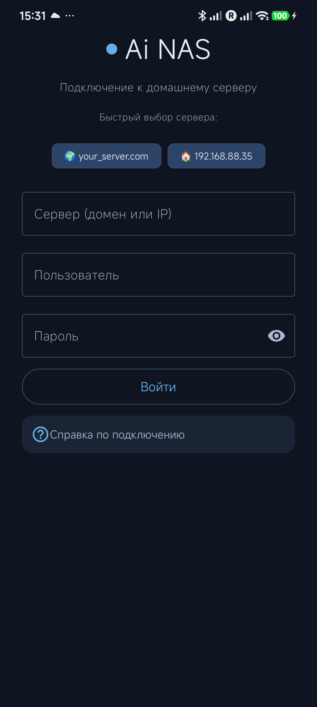
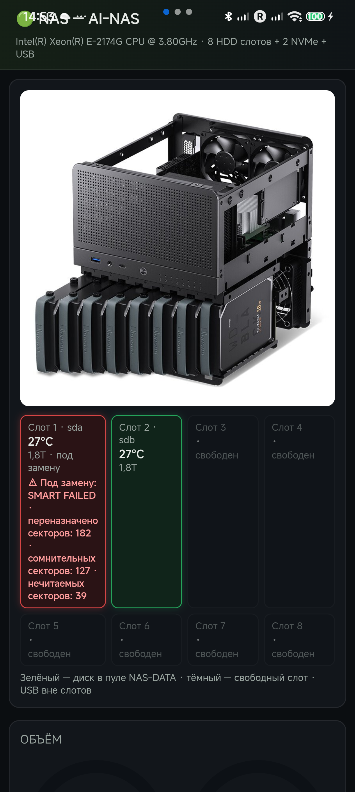
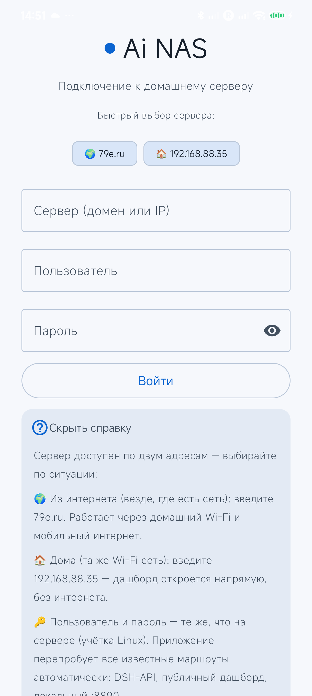
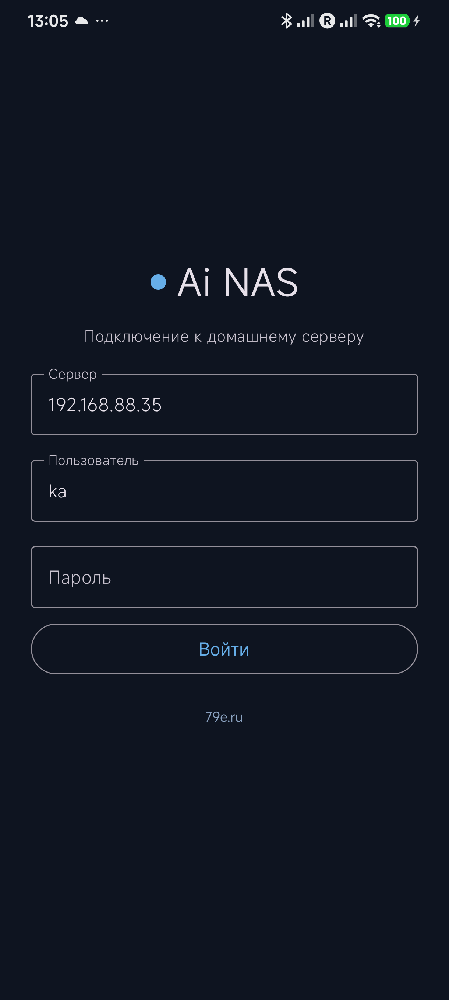
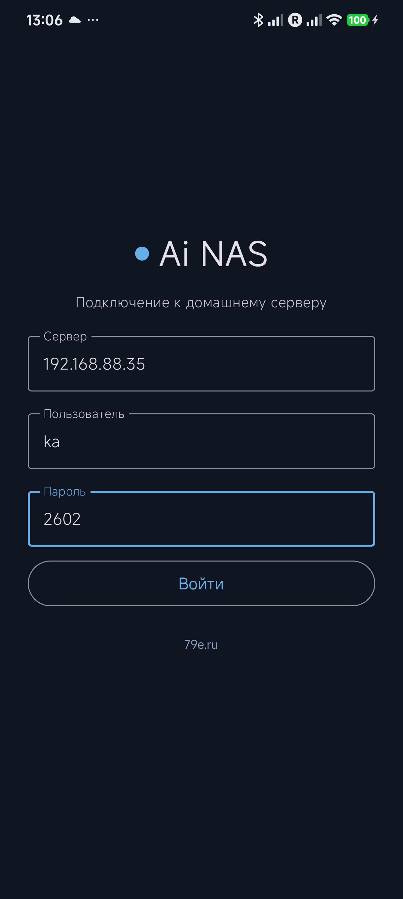

#  🚀 Ai NAS — Android-клиент домашнего сервера

<p align="center">
  
  <br><b>Корпус NAS · три диска · AI-искра</b> ✨
</p>

<p align="center">
  
  &nbsp;
  
  &nbsp;
  
</p>

> **Ai NAS** = Synology Drive + Synology Photos + дашборд сервера + удалённый рабочий стол — в одном лёгком приложении под Android. Kotlin + Jetpack Compose + Material 3. 🧡

---

## ✨ Что умеет

| 🔧 Возможность | 📝 Описание |
|---|---|
| 📊 **Дашборд NAS** | Живые SMART-данные, температуры дисков, пул NAS-DATA, слоты корпуса — прямо на телефоне |
| 🖥 **Рабочий стол** | noVNC-канал к Ubuntu-сессии сервера (`/ubuntu/`) |
| 🌐 **DSH GUI** | Встроенная страница DeepSeek Harness (`/dsh/`) + сопряжение через Chrome Custom Tabs |
| 📁 **Файл-менеджер** | SMB, SFTP и WebDAV в одном списке: загрузки, переименование, избранное, «сохранить на устройство» |
| 📷 **Автосинк фото** | WorkManager-выгрузка снимков на NAS (foreground-service, уведомление о прогрессе) |
| 🔄 **Автообновления** | Проверка GitHub Releases и установка APK в пару тапов |
| 🌗 **Тема** | Автоматически следует системной светлой/тёмной — полная Material 3 палитра |
| 🧩 **Умное подключение** | Само перебирает маршруты: DSH-API → публичный дашборд `/info/` → DSH GUI → локальный `:8890` → корень |

## 🔌 Как подключиться

Сервер доступен **по двум адресам** — выбирайте по ситуации:

| Ситуация | Что вводить в поле «Сервер» | Как работает |
|---|---|---|
| 🌍 **Из интернета** (мобильная сеть, чужой Wi-Fi) | `your_server.com` | HTTPS-туннель через VPS (nginx → SSH reverse-tunnel) |
| 🏠 **Дома** (та же Wi-Fi сеть) | `192.168.88.35` | Напрямую: дашборд `http://<ip>:8890/`, без интернета |

- 👤 **Логин/пароль** — ваша учётка Linux на сервере.
- 🔎 Приложение само найдёт живой маршрут — ждать «подбора» несколько секунд нормально.
- ⚠️ `401` = неверные данные учётной записи (не проблема сети). «Сервер недоступен» = маршруты не отвечают — проверьте сеть или смените адрес.

### 🗺 Карта маршрутов сервера

| Публичный путь (your_server.com) | Локальный путь (192.168.88.35) | Что это |
|---|---|---|
| `https://your_server.com/info/` | `http://192.168.88.35:8890/` | Дашборд NAS |
| `https://your_server.com/dsh/` | — | DSH GUI |
| `https://your_server.com/ubuntu/` | — | noVNC-рабочий стол |
| `https://your_server.com/apk/` | — | Прямая ссылка на APK |

Туннель держит SSH с ключом `id_ed25519_ai-nas`:
`-R 127.0.0.1:18080→:8080 (DSH) -R 127.0.0.1:18081→127.0.0.1:8085 (noVNC) -R 127.0.0.1:18082→:8890 (дашборд) root@your_server.com`.

## 📲 Установка

1. Скачайте APK: `https://your_server.com/apk/ainas-1.1.0.apk` 📥
2. Откройте файл → разрешите установку из этого источника.
3. Play Защита может ворчать на self-signed сборку: «Подробнее» → «Все равно установить» → введите PIN. 🛡
4. Войдите: сервер `your_server.com`, ваша учётка. Готово! ✅

## 🏗 Сборка из исходников

```bash
git clone https://github.com/rukazax/ai-nas.git
cd ai-nas
echo "sdk.dir=/path/to/android-sdk" > local.properties
gradle assembleDebug        # Gradle 8.9, AGP, compileSdk 35
# APK: app/build/outputs/apk/debug/app-debug.apk
```

Требования: JDK 17 ☕, Android SDK 35.

## 🖼 Скриншоты

Версия 1.0.0 (история):

| Вход (тёмная) | Ошибка подключения | Дашборд |
|---|---|---|
|  |  |  |

Актуальные скриншоты v1.1.0 — в начале README и в папке [`screenshots/`](screenshots/).

## 🗂 Структура

```
app/src/main/kotlin/ru/ainas/app/
├── auth/AuthStore.kt      # сессия, multi-route probe, DataStore
├── net/                   # OkHttp, SMB/SFTP/WebDAV провайдеры, PhotoSyncWorker
├── ui/                    # Compose: тема, логин, пейджер (дашборд/десктоп/DSH), файлы
└── up/UpdateChecker.kt    # автообновления через GitHub Releases
```

## 📜 Лицензия

MIT © 2026 rukazax
