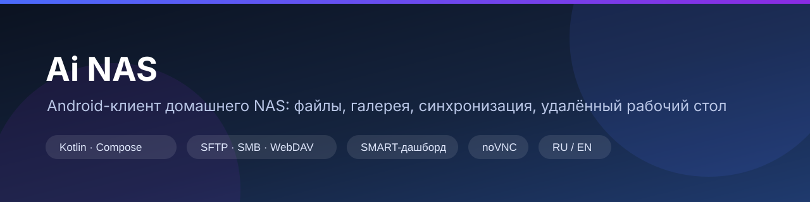
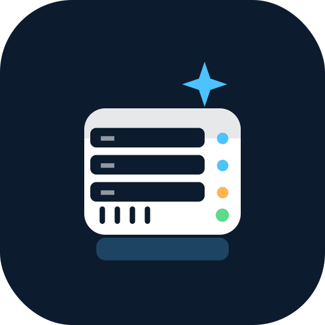
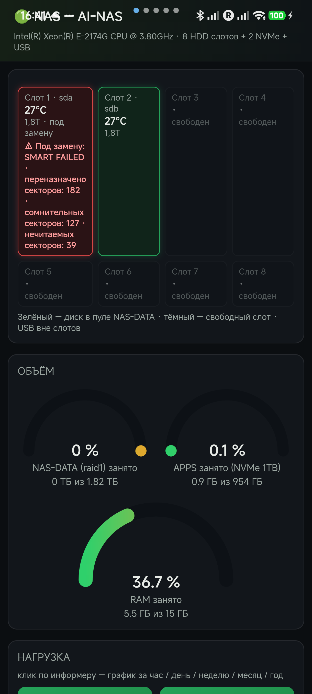
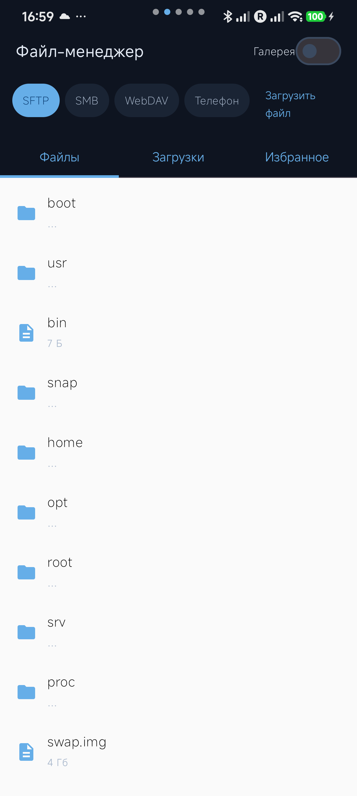
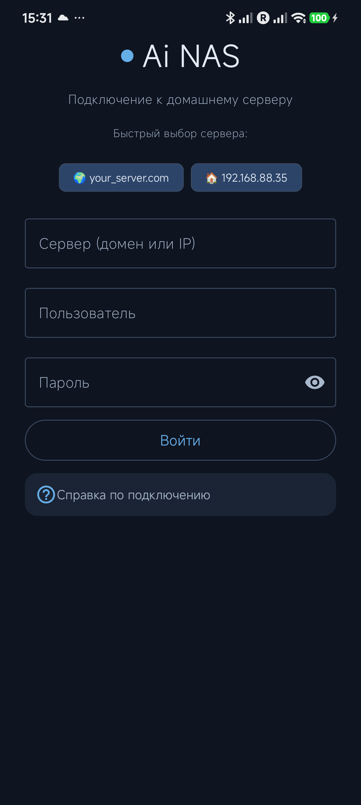

<div align="center">
  
</div>

#  🚀 Ai NAS — Android-клиент домашнего сервера

**RU** · [English](#english)

<p align="center">
  <a href="https://github.com/rukazax"></a>
  <a href="https://github.com/rukazax/ai-nas/releases"></a>
  <a href="https://github.com/rukazax/ai-nas/releases"></a>
  <a href="#-лицензия"></a>
</p>

> **Ai NAS** — Android-клиент домашнего AI-NAS сервера (Kotlin + Jetpack Compose + Material 3): дашборд SMART, файл-менеджер SFTP·SMB·WebDAV·Телефон, фото/видео галерея, синхронизация папок, noVNC-рабочий стол и автообновления. По сути — Synology Drive + Synology Photos + дашборд сервера + удалённый рабочий стол в одном лёгком приложении. 🧡

<p align="center">
  
  <br><b>Корпус NAS · три HDD-лотка · LED · AI-искра</b> ✨
</p>

<p align="center">
  
  &nbsp;
  
  &nbsp;
  
</p>

**v1.2.0 — «всё в одном»**: функциональность уровня X-plore (файлы телефона ↔ NAS + фото/видео галерея) и Syncthing (пары папок с двусторонней синхронизацией) теперь встроена в приложение. Одна учётная запись — все пять экранов сразу.

**v1.2.1 — стабилизация**: клики SMB/WebDAV больше не роняют приложение, вкладки **DSH и ubuntu реально открываются** (раньше — тёмный пустой экран), тёмная тема работает и в моменте, свайпы отрабатывают от любой кромки. Новая иконка в стиле лицевой панели NAS. 🗄

---

## 🧭 Навигация

| Раздел | О чём |
|---|---|
| [✨ Что умеет (v1.2.1)](#-что-умеет-v121) | Пять экранов, круговой свайп, пары папок |
| [🛠 Что нового в 1.2.1](#-что-нового-в-121) | Пять исправленных причин крэшей и пустых страниц |
| [🛠 Что нового в 1.2.0](#-что-нового-в-120) | Три критические причины неработающих файлов |
| [🔌 Как подключиться](#-как-подключиться) | Два адреса сервера, учётка, карта маршрутов |
| [📲 Установка](#-установка) | APK из Releases, обновления из приложения |
| [🏗 Сборка из исходников](#-сборка-из-исходников) | Gradle 8.9, JDK 17, Android SDK 35 |
| [🖼 Скриншоты](#-скриншоты) | Картинки по версиям |
| [🗂 Структура](#-структура) | Где что лежит в коде |
| [📜 Лицензия](#-лицензия) | MIT |
| [English](#english) | Полная английская версия |

---

## ✨ Что умеет (v1.2.1)

Навигация — **свайпом по кругу**: `Дашборд → Файлы → DSH → ubuntu → Настройки → Дашборд…` и обратно. При первом входе все экраны авторизуются автоматически и остаются доступны при каждом открытии приложения.

| 📱 Экран | 📝 Возможности |
|---|---|
| 📊 **Дашборд** | Живые SMART-данные, температуры дисков, пул NAS-DATA, слоты корпуса, RAM/объёмы — прямо на телефоне |
| 📁 **Файл-менеджер** | Четыре источника в одном списке: **SFTP · SMB · WebDAV · Телефон**. Вкладки «Файлы / Загрузки / Избранное», кнопка **«Загрузить файл»** — любой файл с телефона на NAS одним нажатием |
| 🖼 **Галерея** | Переключатель на вкладке файлов: сетка фото/видео с NAS или телефона, полноэкранный просмотр со свайпами между кадрами |
| 🖥 **ubuntu** | noVNC-рабочий стол сервера (`/ubuntu/`) — полный доступ к десктопу Ubuntu |
| 🌐 **DSH** | Встроенная страница DeepSeek Harness (`/dsh/`) + сопряжение через Chrome Custom Tabs |
| ⚙️ **Настройки** | Тема (светлая/тёмная/системная), автозагрузка фото (Wi-Fi only), пары папок, адреса сервера (публичный/домашний), автообновления |

### 🔄 Синхронизация папок (как в Syncthing)

На вкладке «Настройки» создаются **пары папок**: папка на телефоне ⇄ папка на NAS.

- 🔁 **Двусторонний режим**: изменения в обе стороны, новые фото с камеры долетают до NAS сами
- 🧰 Фоновый воркер (WorkManager) + **мгновенная реакция** на свежие снимки через MediaStore — не ждёт планового запуска
- 📶 Опция «только Wi-Fi», уведомление о прогрессе выгрузки

## 🛠 Что нового в 1.2.1

Исправлены 5 причин крэшей и пустых страниц, найденные на живом устройстве (с логами и CDP-отладкой WebView):

| 🐛 Проблема | ✅ Решение |
|---|---|
| 💥 Клик по **SMB** ронял приложение | Прячем `NetworkOnMainThreadException`: jcifs `BaseContext` создаётся лениво в IO-потоке (ленивый `by lazy`), а также включён `jcifs.smb.useRawNTLM` — NTLMSSP без SPNEGO, которому нужен недоступный класс BouncyCastle |
| 💥 Клик по **WebDAV** тоже падал | Sardine на Apache HttpClient не живёт на Android 9+ (`AllowAllHostnameVerifier.INSTANCE` удалён) — WebDAV переписан прямо на OkHttp + XmlPullParser в [`WebDavProvider.kt`](app/src/main/kotlin/ru/ainas/app/net/WebDavProvider.kt); ошибки показываются текстом («WebDAV: HTTP 404…»), а не крэшем |
| ◍ Экран **DSH** — тёмная пустота | Двойная причина: WebView на HyperOS не резолвит `height:100%` у html/body (высота = 0) → на page finished инъекция явной высоты; плюс статические assets DSH требует Basic, а WebView не пробрасывает basic для под-ресурсов → `shouldInterceptRequest` проксирует ресурсы с заголовком Authorization |
| 🔁 «Спиннер»-цикл DSH | SPA снимала `token=` из URL, и это считалось потерей сессии → запрос pair → снова снятие… Потерей теперь считается только редирект на `/dsh/pair` или `/dsh/login` |
| 🌗 Тема не применялась на лету | Источник темы один — `MainActivity` (SYSTEM/LIGHT/DARK из настроек); корень обёрнут `Surface` в цветах темы — «Ищем фото и видео…» больше не вспыхивает белым в тёмной теме |

Плюс: 🔘 точки-страницы перенесены вниз (не путаются с шапкой дашборда), ↔ кромочные свайпы (34dp) работают на **всех** страницах — листать можно даже изнутри WebView, 🗄 **новая иконка**: лицевая панель NAS с тремя HDD-лотками, LED-индикаторами и AI-искрой.

## 🛠 Что нового в 1.2.0

Исправлены 3 критические причины, по которым файлы и страницы не работали:

| 🐛 Проблема | ✅ Решение |
|---|---|
| Файловый менеджер был пуст с v1.1.0 | SFTP-листинг выполнялся в главном потоке (`NetworkOnMainThreadException`), ошибка показывалась как «папка пуста» — перенос в фон |
| SSH-подключение рвалось на handshake | `X25519` реализован через полный BouncyCastle (встроенный Android-BC его не умеет) |
| `your_server.com:22` — SSH VPS, а не NAS | SFTP/SMB теперь сами уходят на **домашний адрес** (`192.168.88.35`), адрес редактируется в настройках |
| Белый экран страниц DSH/ubuntu на HyperOS | Три WebView в пейджере и `beyondViewportPageCount=2` — конфигурация пейджера исправлена |
| Тормоза и лишний расход батареи | WebView вне экрана ставится на паузу, состояния страниц сохраняются (`rememberSaveable`) |

## 🔌 Как подключиться

Сервер доступен **по двум адресам** — выбирайте по ситуации:

| Ситуация | Что вводить в поле «Сервер» | Как работает |
|---|---|---|
| 🌍 **Из интернета** (мобильная сеть, чужой Wi-Fi) | `your_server.com` | HTTPS-туннель через VPS (nginx → SSH reverse-tunnel) |
| 🏠 **Дома** (та же Wi-Fi сеть) | `192.168.88.35` | Напрямую: дашборд `http://<ip>:8890/`, без интернета |

- 👤 **Логин/пароль** — ваша учётка Linux на сервере. Одной авторизации достаточно для всех пяти экранов.
- 🔎 Приложение само найдёт живой маршрут — ждать «подбора» несколько секунд нормально.
- 📁 Для файлового менеджера NAS-адрес (`192.168.88.35`) можно изменить на странице «Настройки».
- ⚠️ `401` = неверные данные учётной записи (не проблема сети). «Сервер недоступен» = маршруты не отвечают — проверьте сеть или смените адрес.

### 🗺 Карта маршрутов сервера

| Публичный путь (your_server.com) | Локальный путь (192.168.88.35) | Что это |
|---|---|---|
| `https://your_server.com/info/` | `http://192.168.88.35:8890/` | Дашборд NAS |
| `https://your_server.com/dsh/` | — | DSH GUI |
| `https://your_server.com/ubuntu/` | — | noVNC-рабочий стол |
| `https://your_server.com/apk/` | — | APK за логином |

Туннель держит SSH с ключом `id_ed25519_ai-nas`:
`-R 127.0.0.1:18080→:8080 (DSH) -R 127.0.0.1:18081→127.0.0.1:8085 (noVNC) -R 127.0.0.1:18082→:8890 (дашборд) root@your_server.com`.

## 📲 Установка

1. Скачайте APK со страницы [Releases](https://github.com/rukazax/ai-nas/releases/latest) (или `https://your_server.com/apk/` — нужен логин сервера) 📥
2. Откройте файл → разрешите установку из этого источника.
3. Play Защита может ворчать на self-signed сборку: «Подробнее» → «Все равно установить» → введите PIN. 🛡
4. Войдите: сервер `your_server.com`, ваша учётка. Все экраны появятся сами — листайте свайпом по кругу! ✅
5. Обновления ставятся прямо из приложения: «Настройки» → «Проверить обновления».

## 🏗 Сборка из исходников

```bash
git clone https://github.com/rukazax/ai-nas.git
cd ai-nas
echo "sdk.dir=/path/to/android-sdk" > local.properties
gradle assembleDebug        # Gradle 8.9, AGP, compileSdk 35
# APK: app/build/outputs/apk/debug/app-debug.apk
```

Требования: JDK 17 ☕, Android SDK 35.

## 🖼 Скриншоты

Актуальные — в начале README и в папке [`screenshots/`](screenshots/). История:

| Версия | Скриншоты |
|---|---|
| **1.2.1** | [Иконка](screenshots/v1.2.1-icon.png) · [DSH GUI](screenshots/v1.2.1-dsh.png) |
| **1.2.0** | [Дашборд](screenshots/v1.2.0-01-dashboard.png) · [Файлы](screenshots/v1.2.0-02-files.png) |
| **1.1.0** | [Вход (тёмная)](screenshots/v1.1.0-login-dark.png) · [Справка](screenshots/v1.1.0-help.png) |
| **1.0.0** | [Вход](screenshots/v1.0.0-login-dark.png) · [Ошибка](screenshots/v1.0.0-login-error.png) · [Дашборд](screenshots/v1.0.0-dashboard.png) |

## 🗂 Структура

```
app/src/main/kotlin/ru/ainas/app/
├── auth/AuthStore.kt         # сессия, multi-route probe, DataStore
├── auth/DshPair.kt           # сопряжение с DSH
├── net/                      # OkHttp, SFTP/SMB/WebDAV провайдеры
│   └── PhotoSyncWorker.kt    # фоновая автозагрузка фото (WorkManager)
├── sync/FolderSync.kt        # пары папок телефон ⇄ NAS (двусторонняя синхронизация)
├── settings/SettingsStore.kt # тема, Wi-Fi only, адреса серверов, пары
├── favorites/                # избранное файлов
├── ui/                       # Compose: круговой пейджер 5 экранов,
│   ├── FilesScreenMain.kt    #   файл-менеджер с источниками и загрузкой
│   ├── GalleryScreen.kt      #   фото/видео галерея
│   ├── SettingsScreen.kt     #   настройки + пары папок
│   └── Screens.kt            #   дашборд / noVNC / DSH WebView
└── up/UpdateChecker.kt       # автообновления через GitHub Releases
```

## 📜 Лицензия

MIT © 2026 rukazax

---

## English

**Ai NAS** — an Android client for a home AI-NAS server.

Ai NAS is an Android client for a home AI-NAS server (Kotlin + Jetpack Compose + Material 3): SMART dashboard, SFTP·SMB·WebDAV·Phone file manager, photo/video gallery, folder sync, a noVNC desktop and in-app updates. In essence — Synology Drive + Synology Photos + a server dashboard + a remote desktop in one lightweight app. 🧡

### Features (v1.2.1)

Navigation is a **circular swipe**: `Dashboard → Files → DSH → ubuntu → Settings → Dashboard…` and back. On first launch all screens authorize automatically and stay available every time you open the app.

| 📱 Screen | 📝 What it does |
|---|---|
| 📊 **Dashboard** | Live SMART data, disk temperatures, the NAS-DATA pool, case drive slots, RAM/volumes — right on the phone |
| 📁 **File manager** | Four sources in one list: **SFTP · SMB · WebDAV · Phone**. «Files / Downloads / Favorites» tabs and an **Upload file** button — any file from the phone to the NAS in one tap |
| 🖼 **Gallery** | A toggle on the files tab: a photo/video grid from the NAS or the phone, full-screen browsing with swipes |
| 🖥 **ubuntu** | The server's noVNC desktop (`/ubuntu/`) — full access to the Ubuntu desktop |
| 🌐 **DSH** | The embedded DeepSeek Harness page (`/dsh/`) + pairing via Chrome Custom Tabs |
| ⚙️ **Settings** | Theme (light/dark/system), photo auto-upload (Wi-Fi only), folder pairs, server addresses (public/home), in-app updates |

### Folder sync (Syncthing-style)

On the Settings tab you create **folder pairs**: a folder on the phone ⇄ a folder on the NAS.

- 🔁 **Two-way mode**: changes in both directions — new camera photos reach the NAS on their own
- 🧰 A background worker (WorkManager) + **instant reaction** to fresh shots via MediaStore — no waiting for the scheduled run
- 📶 A «Wi-Fi only» option and an upload-progress notification

### What's new in 1.2.1

Five crash and blank-screen causes found on a live device (with logs and CDP debugging of the WebView) are fixed:

| 🐛 Problem | ✅ Fix |
|---|---|
| 💥 Tapping **SMB** crashed the app | `NetworkOnMainThreadException` eliminated: the jcifs `BaseContext` is now created lazily on the IO thread (a `by lazy`), and `jcifs.smb.useRawNTLM` is enabled — NTLMSSP without SPNEGO, which needs an unavailable BouncyCastle class |
| 💥 Tapping **WebDAV** crashed too | Sardine on Apache HttpClient doesn't survive Android 9+ (`AllowAllHostnameVerifier.INSTANCE` removed) — WebDAV was rewritten directly on OkHttp + XmlPullParser in [`WebDavProvider.kt`](app/src/main/kotlin/ru/ainas/app/net/WebDavProvider.kt); errors are shown as text («WebDAV: HTTP 404…»), not as crashes |
| ◍ The **DSH** screen was a dark void | Two causes: WebView on HyperOS doesn't resolve `height:100%` on html/body (height = 0) → an explicit height is injected on page finished; plus DSH static assets require Basic auth, and WebView doesn't forward basic for sub-resources → `shouldInterceptRequest` proxies resources with an Authorization header |
| 🔁 The DSH «spinner» loop | The SPA stripped `token=` from the URL, which counted as a lost session → a pair request → stripping again… Now only a redirect to `/dsh/pair` or `/dsh/login` counts as a loss |
| 🌗 The theme wasn't applied on the fly | The theme has a single source — `MainActivity` (SYSTEM/LIGHT/DARK from settings); the root is wrapped in a theme-colored `Surface` — «Looking for photos and videos…» no longer flashes white in the dark theme |

Plus: 🔘 page dots moved to the bottom (they no longer mix with the dashboard header), ↔ edge swipes (34dp) work on **all** pages — you can swipe even from inside a WebView, 🗄 **a new icon**: the NAS front panel with three HDD trays, LEDs and an AI spark.

### What's new in 1.2.0

Three critical causes of broken files and pages are fixed:

| 🐛 Problem | ✅ Fix |
|---|---|
| The file manager was empty since v1.1.0 | SFTP listing ran on the main thread (`NetworkOnMainThreadException`) and the error was shown as «the folder is empty» — moved to the background |
| The SSH connection broke on handshake | `X25519` implemented through full BouncyCastle (the built-in Android-BC can't do it) |
| `your_server.com:22` was the SSH VPS, not the NAS | SFTP/SMB now go to the **home address** (`192.168.88.35`) by themselves; the address is editable in settings |
| Blank DSH/ubuntu pages on HyperOS | Three WebViews in the pager and `beyondViewportPageCount=2` — the pager configuration is fixed |
| Slowness and extra battery drain | An off-screen WebView is paused; page states are kept (`rememberSaveable`) |

### Connecting

The server is reachable at **two addresses** — pick one for your situation:

| Situation | What to enter in the «Server» field | How it works |
|---|---|---|
| 🌍 **From the internet** (mobile network, someone else's Wi-Fi) | `your_server.com` | An HTTPS tunnel via a VPS (nginx → SSH reverse-tunnel) |
| 🏠 **At home** (the same Wi-Fi network) | `192.168.88.35` | Directly: dashboard `http://<ip>:8890/`, no internet needed |

- 👤 **Login/password** — your Linux account on the server. One authorization is enough for all five screens.
- 🔎 The app finds a live route by itself — waiting a few seconds of «probing» is normal.
- 📁 For the file manager the NAS address (`192.168.88.35`) can be changed on the Settings page.
- ⚠️ `401` = wrong account credentials (not a network problem). «Server unavailable» = the routes don't answer — check the network or change the address.

### Server route map

| Public path (your_server.com) | Local path (192.168.88.35) | What it is |
|---|---|---|
| `https://your_server.com/info/` | `http://192.168.88.35:8890/` | NAS dashboard |
| `https://your_server.com/dsh/` | — | DSH GUI |
| `https://your_server.com/ubuntu/` | — | noVNC desktop |
| `https://your_server.com/apk/` | — | APK behind the login |

The tunnel keeps SSH with the `id_ed25519_ai-nas` key:
`-R 127.0.0.1:18080→:8080 (DSH) -R 127.0.0.1:18081→127.0.0.1:8085 (noVNC) -R 127.0.0.1:18082→:8890 (dashboard) root@your_server.com`.

### Installation

1. Download the APK from the [Releases](https://github.com/rukazax/ai-nas/releases/latest) page (or `https://your_server.com/apk/` — server login required) 📥
2. Open the file → allow installs from this source.
3. Play Protect may grumble about a self-signed build: «More details» → «Install anyway» → enter the PIN. 🛡
4. Sign in: server `your_server.com`, your account. All screens appear by themselves — swipe around the circle! ✅
5. Updates install right in the app: «Settings» → «Check for updates».

### Building from source

```bash
git clone https://github.com/rukazax/ai-nas.git
cd ai-nas
echo "sdk.dir=/path/to/android-sdk" > local.properties
gradle assembleDebug        # Gradle 8.9, AGP, compileSdk 35
# APK: app/build/outputs/apk/debug/app-debug.apk
```

Requirements: JDK 17 ☕, Android SDK 35.

### Screenshots

Current ones are at the top of the README and in [`screenshots/`](screenshots/). History (the same images as in the Russian part above):

| Version | Screenshots |
|---|---|
| **1.2.1** | [Icon](screenshots/v1.2.1-icon.png) · [DSH GUI](screenshots/v1.2.1-dsh.png) |
| **1.2.0** | [Dashboard](screenshots/v1.2.0-01-dashboard.png) · [Files](screenshots/v1.2.0-02-files.png) |
| **1.1.0** | [Login (dark)](screenshots/v1.1.0-login-dark.png) · [Help](screenshots/v1.1.0-help.png) |
| **1.0.0** | [Login](screenshots/v1.0.0-login-dark.png) · [Error](screenshots/v1.0.0-login-error.png) · [Dashboard](screenshots/v1.0.0-dashboard.png) |

### Project structure

```
app/src/main/kotlin/ru/ainas/app/
├── auth/AuthStore.kt         # session, multi-route probe, DataStore
├── auth/DshPair.kt           # pairing with DSH
├── net/                      # OkHttp, SFTP/SMB/WebDAV providers
│   └── PhotoSyncWorker.kt    # background photo auto-upload (WorkManager)
├── sync/FolderSync.kt        # phone ⇄ NAS folder pairs (two-way sync)
├── settings/SettingsStore.kt # theme, Wi-Fi only, server addresses, pairs
├── favorites/                # file favorites
├── ui/                       # Compose: a circular pager of 5 screens,
│   ├── FilesScreenMain.kt    #   file manager with sources and upload
│   ├── GalleryScreen.kt      #   photo/video gallery
│   ├── SettingsScreen.kt     #   settings + folder pairs
│   └── Screens.kt            #   dashboard / noVNC / DSH WebView
└── up/UpdateChecker.kt       # in-app updates via GitHub Releases
```

### License

MIT © 2026 rukazax

---

#android #kotlin #jetpack-compose #nas #self-hosted #sftp #smb #webdav #syncthing #novnc #material3 #smart-dashboard
